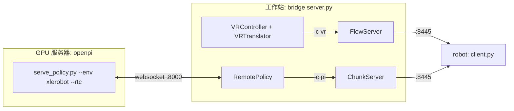

# xlerobot 统一入口改造

## 目标架构



完成后的依赖方向：bridge 不 import openpi，openpi 也不 import bridge，两者只通过 websocket 协议对接。这套协议本来就是同一个：先发 metadata，然后循环收 obs、发 `actions`。

调研中顺带发现：[openpi/scripts/serve_xlerobot.py](openpi/scripts/serve_xlerobot.py) 第 47 行引用的 `xlerobot_policy.XlerobotRawInputs` 已经不存在，现在的名字是 `XlerobotRawInputsRepack`。所以这个脚本目前是跑不起来的，删掉它不会损失任何能用的功能。

## 一、openpi：回到纯推理服务

- 在 [openpi/scripts/serve_policy.py](openpi/scripts/serve_policy.py) 中：
  - 给 `EnvMode` 加一项 `XLEROBOT = "xlerobot"`。
  - 新增一张按环境区分的推理侧 repack 映射表，`Checkpoint` 和 `Default` 两个分支都要把它传给 `create_trained_policy(..., repack_transforms=...)`：
    ```python
    ENV_REPACK_TRANSFORMS: dict[EnvMode, _transforms.Group] = {
        EnvMode.XLEROBOT: _transforms.Group(inputs=[xlerobot_policy.XlerobotRawInputsRepack()]),
    }
    ```
  - 不给 xlerobot 加 `DEFAULT_CHECKPOINT`，checkpoint 始终通过 `policy:checkpoint` 显式指定。
- 删除 [openpi/scripts/serve_xlerobot.py](openpi/scripts/serve_xlerobot.py)。
- 在 [openpi/pyproject.toml](openpi/pyproject.toml) 中删除 `dependencies` 里的 `"bridge"`，以及 `[tool.uv.sources]` 里的 `bridge = { path = "../bridge", editable = true }`，然后执行 `uv lock`。
- 顺手更新 [openpi/src/openpi/policies/xlerobot_policy.py](openpi/src/openpi/policies/xlerobot_policy.py) 和 [openpi/src/openpi/training/config.py](openpi/src/openpi/training/config.py) 中 `XlerobotDataConfig` 的 docstring，把 "bridge ChunkClient" 的说法改成 "raw XLerobot observation"。

## 二、bridge：server.py 成为唯一入口

- 新增 `bridge/src/bridge/controllers/policy/remote.py`，实现 `RemotePolicy`：
  - 复用 bridge 已有的 `bridge.utils.msgpack_numpy`，用同步 websocket 连接 openpi 的服务。逻辑与 `openpi_client.WebsocketClientPolicy` 相同：连上后等待服务端、收 metadata，然后提供 `infer(obs)` 和 `get_server_metadata()`。
  - 选择自己实现而不是依赖 `openpi-client`，是因为工作站上不一定有 openpi 仓库，这样可以避免再引入跨仓库的 path 依赖。代码大约 30 行。
- 在 [bridge/src/bridge/runtime/server.py](bridge/src/bridge/runtime/server.py) 的 `ChunkServer._send_action` 中，把 `self._policy.infer(obs)` 改成 `await asyncio.to_thread(self._policy.infer, obs)`。远程推理会阻塞几十到几百毫秒，放到线程里可以避免卡住 event loop，`/healthz` 等请求也能照常响应。
- 补全 [bridge/space/xlerobot/server.py](bridge/space/xlerobot/server.py) 中的 `Agent.PI` 分支：
  - 在 `Args` 中新增 `policy_host: str = "localhost"` 和 `policy_port: int = 8000`。
  - 分支实现：
    ```python
    case Agent.PI:
        policy = RemotePolicy(host=args.policy_host, port=args.policy_port)
        return ChunkServer(
            policy=policy,
            host=args.host,
            port=args.port,
            metadata={"mode": "pi", **policy.get_server_metadata()},
        )
    ```
- 机器人端 [bridge/space/xlerobot/client.py](bridge/space/xlerobot/client.py) 不需要改，它在两种模式下都连接 server.py 的 8445 端口。

## 三、justfile（放在 bridge 根目录）

新建 `bridge/justfile`。openpi 的路径用变量表示，GPU 服务器上可以通过环境变量覆盖：

```just
openpi_dir := env("OPENPI_DIR", "../openpi")

# GPU 服务器：常驻推理服务
policy config dir port="8000" *args:
    cd {{openpi_dir}} && uv run scripts/serve_policy.py --env xlerobot --rtc --port {{port}} \
        policy:checkpoint --policy.config {{config}} --policy.dir {{dir}} {{args}}

# 工作站：控制源服务，mode = vr | vr_debug | vr_remote | pi
server mode="vr" *args:
    uv run python -m space.xlerobot.server -c {{mode}} {{args}}

# 机器人端：mode = manual | agent
robot mode="manual" *args:
    uv run python -m space.xlerobot.client -m {{mode}} {{args}}
```

典型用法：

- 遥操：先 `just server vr`，再 `just robot manual -r`。
- 策略控制：GPU 服务器上 `just policy pi05_xlerobot_lora checkpoints/...`，工作站上 `just server pi --policy-host <gpu_ip>`，机器人上 `just robot agent`。

本机目前没有安装 `just`，需要执行 `brew install just`（GPU 服务器上用对应平台的安装方式）。

## 四、文档

在 [bridge/README.md](bridge/README.md) 的 ChunkServer 一节补充说明：policy 由 `RemotePolicy` 远程提供；同时新增一个"启动"小节，列出上面的 just 用法。